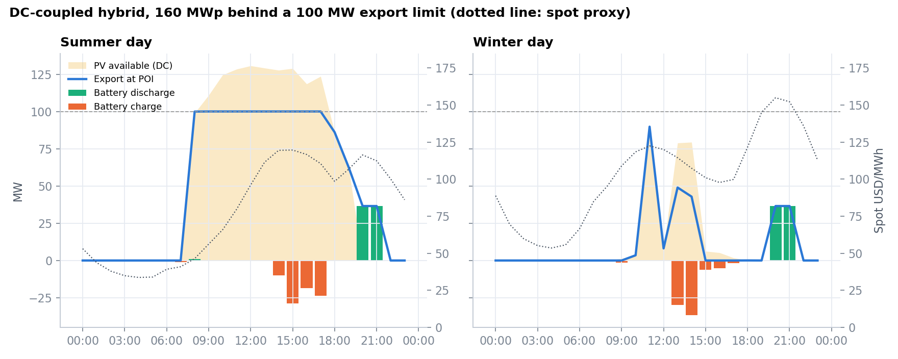
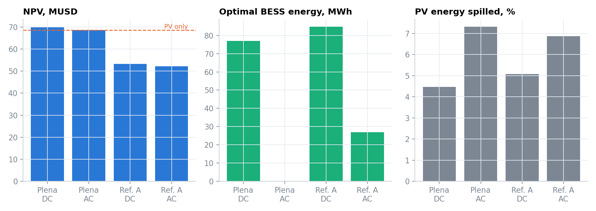
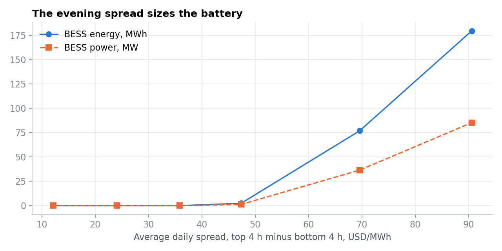
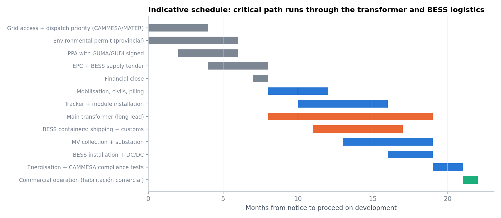

# PV + BESS hybrid under MATER: sizing behind a grid export limit

Joint sizing and dispatch of a **solar + battery hybrid in San Juan (Cuyo)** with a **100 MW export permit**, selling under a MATER PPA to a large user (GUMA/GUDI) plus spot. The model chooses PV DC capacity, inverter capacity and battery power and energy together with 8,760 hours of dispatch, and compares:
- **DC-coupled vs AC-coupled** batteries;
- **Plena vs Referencial A** dispatch priority, where transmission congestion can curtail up to ~8%.

It closes with a development pack: capex build-up, construction schedule and risk register, drawn from my Resident Engineer work on a 67.66 MWp PV + 50 MW/200 MWh BESS project.

> **ES:** Dimensionamiento conjunto (Pyomo/HiGHS) de un híbrido solar + baterías en San Juan con permiso de inyección de 100 MW, PPA MATER con un GUMA/GUDI y venta al spot. Compara acople DC vs AC y prioridad Plena vs Referencial A, e incluye CAPEX, cronograma de obra y matriz de riesgos.



## Key results (long-run prices, all inputs editable)

| Scenario | PV (MWp) | BESS | Export (GWh/yr) | PV spilled | NPV (MUSD) |
|---|---|---|---|---|---|
| PV only, Plena | 155 | n/a | 272 | 7.3% | 68.6 |
| **Hybrid DC, Plena** | **160** | **37 MW / 77 MWh** | **286** | **4.5%** | **70.1** |
| Hybrid AC, Plena | 155 | none built | 272 | 7.3% | 68.6 |
| Hybrid DC, Referencial A | 136 | 40 MW / 85 MWh | 241 | 5.1% | 53.3 |
| Hybrid AC, Referencial A | 131 | 13 MW / 27 MWh | 229 | 6.9% | 52.2 |

Base design capex: 94.8 MUSD (PV 76.8, inverters 5.0, BESS energy 11.5, power conversion 1.5).

**Reading.**
- **At long-run spreads, a co-located battery is marginal, and only DC coupling makes it pay.** A DC-coupled battery charges from energy the inverter would otherwise clip (DC/AC 1.6) and sells it in the evening. That adds +1.5 MUSD of NPV. An AC-coupled battery cannot reach that energy and is not built.
- **Dispatch priority matters more than the battery.** Referencial A costs about 17 MUSD of NPV. The optimiser shrinks the plant (136 MWp, 85 MW inverter) and keeps a ~2-hour DC battery to absorb curtailed midday output.
- **The spread decides the battery case.** No battery is built below about 45 USD/MWh of daily spread (top-4 minus bottom-4 hours). At about 90 USD/MWh it grows to 85 MW / 180 MWh. In Argentina today that spread exists in winter but is not bankable on its own, which is why a capacity contract (AlmaSADI) or a firming PPA is needed for storage to be co-located at scale.




## Development pack
- `results/capex_base.csv`: capex build-up for the base design.
- `results/risk_register.csv`: likelihood, impact and mitigation (transformer lead time, BESS import under capital controls, Referencial A curtailment, piling, CAMMESA compliance tests, spread compression, offtaker credit).



## Method
- **Solar.** PVGIS hourly output for a single-axis tracker at −31.6°, −68.6° (ERA5, 2021, 14% losses).
- **Spot price.** A merit-order proxy built from real CAMMESA SADI demand, as in [argentina-bess-valuation](https://github.com/schiped/argentina-bess-valuation). Each month uses its nearest observed demand shape, scaled to a long-run monthly CMg averaging about 72 USD/MWh.
- **Revenue.** All exports sell at spot. The MATER PPA (60 USD/MWh on 70% of a reference solar profile) is settled as a contract for differences, so it hedges revenue without distorting dispatch.
- **Grid access.**
  - Plena: the full 100 MW at all times.
  - Referencial A: in high-solar hours the export limit drops by κ, calibrated so that a PV-only plant loses 8% of its energy.
- **Model** (`src/hybrid/model.py`). An LP over 8,760 h with a cyclic state of charge. DC/AC ≤ 1.6, inverter ≤ export permit, battery duration between 1 and 6 h. The objective is NPV: annuity × (revenue − O&M) − capex, at a 10% WACC over 25 years.

## Run it
```bash
conda env create -f environment.yml && conda activate energy-portfolio
python data/fetch_data.py --skip-cammesa   # PVGIS profile (CAMMESA demand is already in data/raw)
python run_hybrid.py                       # ~10 min: 4 scenarios + spread sensitivity
streamlit run app.py                       # re-price PPA, capex, WACC; browse weekly dispatch
```

## Limitations
- The price shape is a proxy, so real CAMMESA nodal prices and the curtailment patterns at the Cuyo nodes will differ.
- A representative year with no degradation; the energy-to-power cost split is simplified.

---
Pedro Schiaffi · [LinkedIn](https://www.linkedin.com/in/schiaffipedro) · MIT licence
